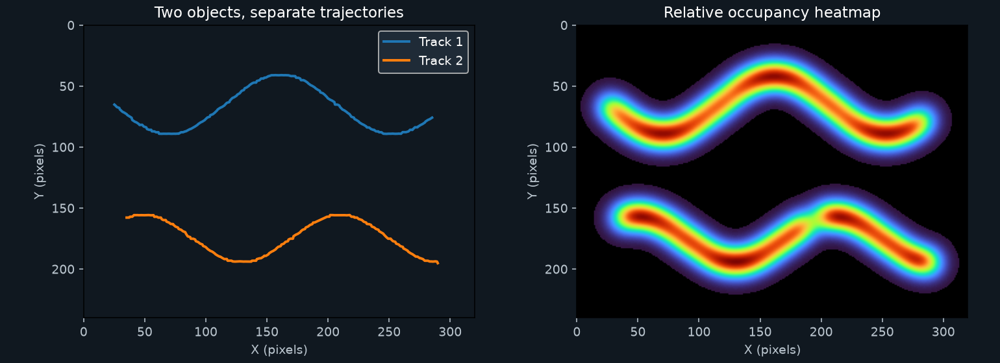

# Video path heatmapper

Track colored markers in a top-down video and see where they spend time. Each object gets an ID, a movement trail, and basic movement statistics. The program runs locally and does not need a model download or GPU.



## Try the example

Use Python 3.11 or newer. From this folder:

```sh
python -m venv .venv
# Windows: .venv\Scripts\activate
# macOS / Linux: source .venv/bin/activate
python -m pip install -r requirements.txt
python sample_video.py
python heatmapper.py gameplay.avi --min-area 30 --annotated
```

The sample contains two red markers, a six-frame disappearance, and a small red noise dot. It produces two tracks and 354 detections across 180 frames. Open `results/annotated.avi` to watch the IDs and trails.

## Use your own footage

```sh
python heatmapper.py gameplay.mp4 --color red --min-area 30 --max-area 500
python heatmapper.py gameplay.mp4 --roi 50 20 640 480 --max-distance 15 --max-gap 8 --annotated
python heatmapper.py gameplay.mp4 --max-frames 300 --output short-run
```

`--roi X Y WIDTH HEIGHT` limits detection to a rectangle, using full-frame coordinates. It must fit inside the video. `--color` accepts red, green, or blue. Use `--fps 30` if the video metadata has no usable frame rate. An override also changes timestamps and speed calculations.

## What gets saved

| File | Contents |
| --- | --- |
| `heat_path.png` | White dots at every detected centroid |
| `tracks.png` | Separate colored trails for the tracked IDs |
| `heat_density.png` | Smoothed, normalized occupancy heatmap |
| `overlay.png` | Heatmap over the first video frame |
| `positions.csv` | Frame, time, ID, X, Y, and component area for every detection |
| `occupancy_seconds.npy` | Unsmoothed floating-point occupancy in seconds per pixel |
| `summary.json` | Configuration, detection coverage, and per-track statistics |
| `annotated.avi` | Video with boxes, IDs, and trails when `--annotated` is used |

The heatmap image is normalized separately for each run. Compare the numerical occupancy arrays when you need consistent units across videos. Occupancy increases at an object's centroid by `1 / fps` for each observed frame; it does not measure the object's full footprint.

## How tracking works

1. Threshold the frame in HSV. Red includes both ends of the hue range.
2. Remove isolated pixels with a small morphological opening and find connected components.
3. Filter components by area and the optional region of interest.
4. Predict each active track's next position from its previous two observations.
5. Greedily match the closest eligible track/detection pairs. Each detection and track can be used once per frame.
6. Keep an unmatched track available for up to `max-gap` missing frames. Start a new ID when no active track matches.

`max-distance` is the allowed deviation from the prediction in pixels per elapsed frame. After a gap, the gate grows with the number of elapsed frames. Reduce it when nearby markers incorrectly swap IDs; increase it when rapid motion creates fragmented tracks.

Distance is the sum of straight segments between observations. Mean speed divides that distance by the time between the first and last observations, including gaps. No position is invented for missing frames. `observed_seconds` counts only detected frames; `span_seconds` measures the first-to-last timestamp span.

This is color-based tracking, not player recognition. Overlapping objects can merge into one blob, and IDs can switch at crossings or after long disappearances. Camera motion, lighting changes, compression, and same-color scenery affect results. Pixel speeds are not physical speeds without spatial calibration. Video decoding stops at EOF or a decoder failure; the summary describes the frames actually read.

## Project layout

`tracking.py` contains detection, association, and statistics. `heatmapper.py` handles video input and output files. `sample_video.py` generates a repeatable two-marker example.

## Tests

```sh
python -m pip install -r requirements-dev.txt
python -m pytest -q
```

Tests cover hue wrapping, noise rejection, ROI bounds, changing detection order, short and long gaps, measured speed, empty detections, and a full video-to-CSV/JSON/annotated-video run. GitHub Actions runs the same suite.
